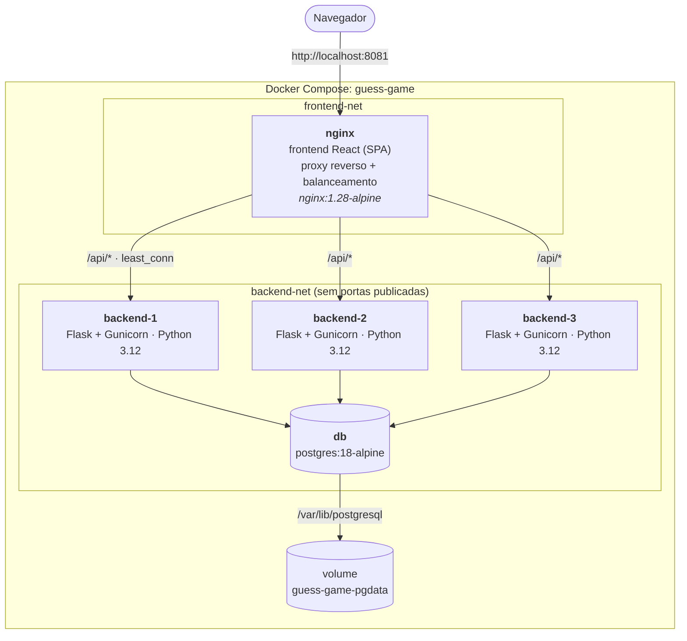

# Guess Game com Docker Compose

Infraestrutura em Docker Compose para o [jogo de adivinhação](https://github.com/fams/guess_game):
backend Flask com várias réplicas, banco Postgres com volume persistente e NGINX servindo o frontend
React e fazendo proxy reverso com balanceamento de carga.

A documentação original do jogo está em [README-REPO-JOGO.md](README-REPO-JOGO.md).

## TL;DR

```bash
git clone https://github.com/ana-delfino/docker_guess_game.git
cd docker_guess_game
docker compose up -d --build
```

**Acesse o host: http://localhost:8081**

- `http://localhost:8081/maker`: cria um jogo (anote o `game_id`)
- `http://localhost:8081/breaker`: tenta adivinhar a senha usando o `game_id`

> Se a porta 8081 estiver ocupada: `HTTP_PORT=8082 docker compose up -d --build`
> (ou altere `HTTP_PORT` no arquivo `.env`).

## Arquitetura



O NGINX participa das duas redes: ele recebe as requisições do navegador e é o único caminho até os
backends. As réplicas do backend e o banco ficam só na `backend-net`, sem portas publicadas no host.

### Arquivos adicionados

| Arquivo | Função |
|---|---|
| [docker-compose.yml](docker-compose.yml) | Orquestra os serviços `db`, `backend` e `nginx`, além de volumes e redes |
| [.env](.env) | Versões das imagens, número de réplicas, porta e credenciais do banco |
| [Dockerfile](Dockerfile) | Imagem do backend Flask servido pelo Gunicorn (`python:3.12-slim`) |
| [frontend/Dockerfile](frontend/Dockerfile) | Build multi-stage: `node:18.17.0` compila o React e `nginx` serve o resultado |
| [nginx/default.conf](nginx/default.conf) | Proxy reverso e balanceamento de carga entre as réplicas do backend |
| `.dockerignore`, `frontend/.dockerignore` | Mantêm o contexto de build pequeno (sem `node_modules`, `.git`, etc.) |

## Decisões de design

### Serviços

- **`db`** (`postgres:18-alpine`): armazena os jogos. O backend cria a tabela `game` sozinho na
  inicialização. O healthcheck usa `pg_isready`.
  O **Postgres 18** foi escolhido por já ser uma versão **consolidada**, com várias atualizações
  de correção publicadas, e com **suporte oficial até novembro de 2030**. Já existe a versão 19,
  mas para a entrega foi priorizada a estabilidade de uma versão madura em vez da mais recente.
  > ⚠️ **Este compose funciona com o Postgres 18 em diante.** 
- **`backend`**: aplicação Flask, configurada só por variáveis de ambiente `FLASK_DB_*`, que o
  próprio Flask lê via `app.config.from_prefixed_env()`. O `start-backend.sh` original não é usado
  porque fixa `FLASK_DB_HOST=localhost`; o host do banco vem do compose (`db`). A aplicação
  continua sendo Flask, mas é executada pelo **Gunicorn** (`run:app`) em vez do `flask run`, que o
  próprio Flask indica apenas para desenvolvimento. O Gunicorn é o servidor de produção
  recomendado: roda vários workers por container e, se um worker morre, sobe outro sem reiniciar o
  container. Ele é instalado só no [Dockerfile](Dockerfile), sem alterar o código nem o
  `requirements.txt`. Roda em **3 réplicas** (`deploy.replicas`) e tem healthcheck na rota `/health`.
- **`nginx`**: imagem construída a partir de `frontend/Dockerfile`, que contém o build do React e
  é servida pelo NGINX. O mesmo container faz o proxy reverso para a API. É o **único serviço que
  publica porta** no host.

### Como o frontend chega ao backend

O frontend usa `process.env.REACT_APP_BACKEND_URL`, que é definido **no build** da imagem como
`/api`. O navegador chama `/api/create` e `/api/guess/<id>` na mesma origem, e o NGINX encaminha
essas chamadas para `backend:5000/create` e `backend:5000/guess/<id>` (removendo o prefixo `/api`).
Com isso:
- não há URL de backend fixa no bundle (funciona em qualquer host ou porta);
- não há requisições cross-origin;
- o backend nunca fica exposto diretamente.

### Balanceamento de carga

```nginx
resolver 127.0.0.11 valid=10s;          # DNS interno do Docker
upstream backend {
    zone backend_zone 64k;
    least_conn;
    server backend:5000 resolve max_fails=3 fail_timeout=10s;
}
```

O navegador chama `/api/...` no NGINX, que repassa cada requisição para uma das réplicas do
serviço `backend`. O NGINX encontra as réplicas pelo DNS interno do Docker: o nome `backend`
responde com o IP de todas elas. Como as réplicas **não são fixas** (o número muda com `--scale` e os
IPs mudam quando um container reinicia ou é atualizado), o NGINX consulta esse DNS a cada 10s
(`resolve`) em vez de usar uma lista fixa, e sempre encaminha para as réplicas que existem no momento.

- Estratégia **`least_conn`**: cada requisição vai para a réplica com menos conexões ativas.
  Como as requisições são curtas, na prática a distribuição fica parecida com round-robin.
- **Failover**: `max_fails`/`fail_timeout` tiram temporariamente uma réplica com problema da
  rotação, e `proxy_next_upstream` reenvia a requisição para outra réplica quando há erro ou timeout.
- O backend não guarda estado em memória (tudo fica no Postgres), então **não é necessário
  sticky session**: qualquer réplica atende qualquer jogo.
- A resposta traz o cabeçalho `X-Upstream`, que mostra qual réplica atendeu.

O backend sobe com **3 réplicas** (`BACKEND_REPLICAS=3` no `.env`) e **não deve ter menos que 3**:
é o mínimo para aguentar uma falha com folga. Se uma réplica cair ou estiver sendo recriada numa
atualização, ainda sobram duas atendendo; com 2, uma falha deixa uma única instância, sem
redundância, e com 1 não há balanceamento. Cada réplica é leve, então três rodam sem problema numa
máquina comum. Para aumentar, altere `BACKEND_REPLICAS` ou use `docker compose up -d --scale backend=N`
com `N ≥ 3`.

### Resiliência

Todos os serviços usam `restart: unless-stopped`: o Docker reinicia o container sempre que ele cai,
inclusive depois de um reinício do Docker ou da máquina, mas respeita uma parada manual
(`docker compose stop`). Foi escolhido no lugar de `on-failure`, que não reinicia se o processo sair
com código 0, e de `always`, que religa até containers parados de propósito.

A recuperação acontece em três níveis. Se um worker do backend morre, o próprio Gunicorn sobe outro
sem reiniciar o container. Se o processo principal cai, o Docker reinicia o container. Enquanto isso,
o NGINX encaminha as requisições para as outras réplicas, e o usuário não percebe a falha. Na
inicialização, o `depends_on` com `condition: service_healthy` faz o backend esperar o Postgres
aceitar conexões; se mesmo assim a conexão falhar, o backend sai com erro e o restart tenta de novo.

Há duas limitações conhecidas. No Docker Compose, os healthchecks (de `db`, `backend` e `nginx`,
visíveis em `docker compose ps`) apenas informam o estado: um container travado, mas ainda em
execução, fica *unhealthy* e não é reiniciado automaticamente; o NGINX só deixa de enviar
requisições a ele. Reiniciar por healthcheck exigiria um orquestrador como Docker Swarm ou
Kubernetes. Além disso, o Postgres é uma instância única e é o único componente sem redundância.

### Volumes

Os dados do Postgres ficam no volume nomeado `guess-game-pgdata`, montado em `/var/lib/postgresql`
(padrão do Postgres 18+). Separar os dados do container é o que permite atualizar o banco trocando
só a imagem: o container pode ser removido, recriado ou atualizado, e os dados continuam no volume.
Eles só são apagados com `docker compose down -v`. Foi usado um volume nomeado, gerenciado pelo
Docker, em vez de uma pasta do host (bind mount), porque funciona igual em Linux, macOS e Windows,
sem problemas de permissão de arquivos e com melhor desempenho no Docker Desktop. O nome é fixo
(`name: guess-game-pgdata`) para não depender do nome da pasta onde o projeto foi clonado.

A configuração do NGINX (`nginx/default.conf`) é montada como somente leitura no container. Assim, a
configuração fica separada da imagem e pode ser ajustada sem rebuild (`docker compose restart nginx`).

### Redes

A aplicação usa duas redes para limitar o que fica exposto. Na `frontend-net` fica apenas o NGINX,
que é o único serviço com porta publicada no host e, portanto, a única porta de entrada do sistema.
Na `backend-net` ficam o backend e o Postgres, que não publicam portas e só podem ser acessados por
dentro dessa rede. O NGINX participa das duas e é o único caminho entre o navegador e o backend. Com
isso, o banco nunca fica acessível de fora, e o backend só recebe requisições que passaram pelo
proxy, o que garante que todo o tráfego passe pelo balanceamento. Dentro de cada rede, os serviços
se encontram pelo nome (`db`, `backend`) através do DNS do Docker, sem depender de IPs.

### Variáveis de ambiente (`.env`)

Todas as configurações que podem mudar ficam no arquivo [.env](.env). O Docker Compose lê esse
arquivo automaticamente ao rodar `docker compose up` e substitui as variáveis `${...}` do
`docker-compose.yml`. Assim, nenhuma configuração fica fixa no compose e não é preciso editá-lo.

| Variável | Para que serve |
|---|---|
| `BACKEND_IMAGE` / `BACKEND_VERSION` | Imagem e versão do backend |
| `FRONTEND_IMAGE` / `FRONTEND_VERSION` | Imagem e versão do frontend (NGINX + React) |
| `POSTGRES_VERSION` / `NGINX_VERSION` | Versões do Postgres e do NGINX base |
| `BACKEND_REPLICAS` | Número de réplicas do backend (mínimo 3) |
| `HTTP_PORT` | Porta do host onde a aplicação fica acessível |
| `POSTGRES_USER` / `POSTGRES_PASSWORD` / `POSTGRES_DB` | Credenciais do banco, usadas pelo Postgres e repassadas ao backend como `FLASK_DB_*` |

Uma variável definida no terminal tem prioridade sobre o `.env`, o que permite testar um valor sem
editar o arquivo (ex.: `HTTP_PORT=8082 docker compose up -d`). O `docker-compose.yml` também traz
valores padrão (`${VAR:-padrão}`), então o projeto sobe mesmo sem o `.env`.

## Instalação e execução

### Pré-requisitos

- Docker 24+ e Docker Compose v2 (`docker compose version`)

### Subir

```bash
docker compose up -d --build
docker compose ps          # todos devem ficar (healthy)
```

Abra **http://localhost:8081**.

### Testar pela linha de comando

```bash
# criar jogo
curl -X POST -H 'Content-Type: application/json' \
     -d '{"password":"docker"}' http://localhost:8081/api/create
# => {"game_id":"abc123"}

# adivinhar
curl -X POST -H 'Content-Type: application/json' \
     -d '{"guess":"docker"}' http://localhost:8081/api/guess/abc123
# => {"result":"Correct"}

# ver o balanceamento (cada chamada mostra uma réplica diferente)
for i in 1 2 3 4 5 6; do curl -s -D - -o /dev/null http://localhost:8081/api/health | grep X-Upstream; done
```

### Operações comuns

```bash
docker compose logs -f backend               # logs de todas as réplicas
docker compose up -d --scale backend=5       # escalar o backend (mínimo 3; o NGINX detecta sozinho)
docker compose down                          # parar tudo (os dados são mantidos)
docker compose down -v                       # parar tudo e APAGAR o banco
```

## Atualização dos componentes

Todas as versões estão centralizadas no arquivo [.env](.env):

```dotenv
BACKEND_IMAGE=guess-game-backend
BACKEND_VERSION=1.0.0
FRONTEND_IMAGE=guess-game-frontend
FRONTEND_VERSION=1.0.0
POSTGRES_VERSION=18-alpine
NGINX_VERSION=1.28-alpine
```

Para atualizar um componente, **troque a versão no `.env`** (ou passe a variável na linha de
comando) e rode `docker compose up -d`. O Compose recria só o serviço que mudou, e o volume do
banco é preservado.

### Backend

```bash
# Nova versão do código: gere a imagem com uma nova tag
BACKEND_VERSION=1.1.0 docker compose build backend
BACKEND_VERSION=1.1.0 docker compose up -d backend
```

Ou, usando uma imagem já publicada em um registry:

```dotenv
BACKEND_IMAGE=meuusuario/guess-game-backend
BACKEND_VERSION=1.1.0
```

```bash
docker compose pull backend && docker compose up -d backend
```

Para voltar à versão anterior, basta restaurar a tag antiga e rodar `docker compose up -d backend` de novo.

### Frontend (React + NGINX)

```bash
FRONTEND_VERSION=1.1.0 docker compose build nginx
FRONTEND_VERSION=1.1.0 docker compose up -d nginx
```

Para trocar só a versão do NGINX base, altere `NGINX_VERSION` (por exemplo `1.28-alpine` → `1.29-alpine`)
e reconstrua a imagem do frontend com uma nova `FRONTEND_VERSION`.
Observação: a opção `resolve` do upstream exige NGINX ≥ 1.27.3. Versões anteriores (1.26 ou menos) não iniciam com essa configuração.

### Banco de dados

```bash
# atualização de patch/minor (mesma major): só trocar a tag
POSTGRES_VERSION=18.1-alpine docker compose up -d db
```

Os dados continuam no volume `guess-game-pgdata`. Para **mudar de major** (por exemplo 18 → 19),
o Postgres exige migração dos dados. Faça um dump antes, troque a versão, recrie o volume e restaure.
Use sempre versões **18 ou superiores**.

```bash
docker compose exec db pg_dumpall -U postgres > backup.sql
docker compose down
docker volume rm guess-game-pgdata
POSTGRES_VERSION=19-alpine docker compose up -d db
cat backup.sql | docker compose exec -T db psql -U postgres
docker compose up -d
```

## Validação realizada

- Fluxo completo pelo NGINX: frontend (`/`, `/maker`, `/breaker`) e API (`/api/create`, `/api/guess/<id>`).
- Requisições distribuídas entre as 3 réplicas (cabeçalho `X-Upstream`).
- Com um backend morto, as requisições continuam respondendo 200 pelas outras réplicas.
- Worker do Gunicorn morto (`SIGKILL`): o Gunicorn subiu outro worker na hora, sem reiniciar o container.
- Processo principal do backend encerrado de forma inesperada: o container foi reiniciado automaticamente
  (`RestartCount=1`) e voltou ao balanceamento.
- `docker compose down` seguido de `up`: o jogo criado antes continua acessível (persistência no volume).
- `--scale backend=4`: a nova réplica entra no balanceamento sem reiniciar o NGINX.
